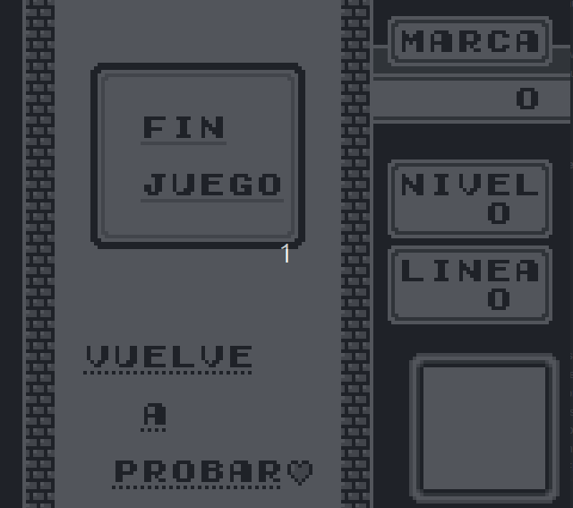
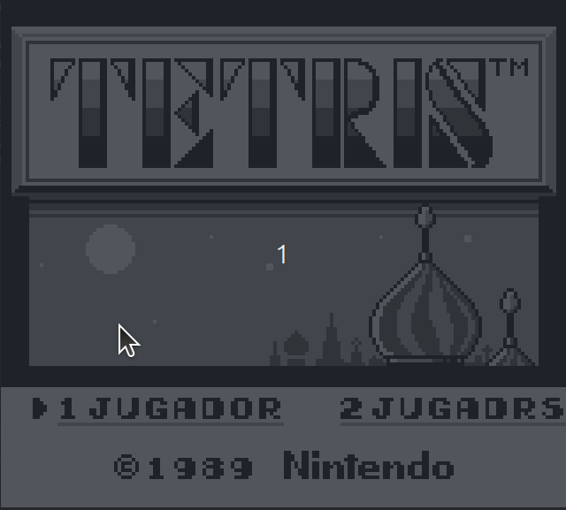
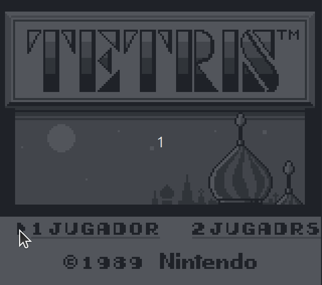

# Java Game Boy Emulator

A Game Boy (DMG) emulator built from scratch in **Java**, capable of running the original Tetris at approximately 60 FPS.

The goal of this project was to understand low-level systems, CPU emulation, memory management, and graphics rendering by building a functional emulator.

## Gameplay

**Tetris running on the emulator**

**Title Screen**

## Features

- Game Boy CPU instruction execution
- Memory Management Unit (MMU)
- Background and sprite rendering (PPU)
- OAM DMA transfers
- Keyboard input through Joypad emulation
- VBlank and timer interrupts
- Approximately 60 FPS
- Playable Tetris

## Architecture

The emulator is organized into independent components:

| Component | Responsibility |
|---|---|
| CPU | Instruction execution and registers |
| MMU | Memory mapping and hardware registers |
| PPU | Background and sprite rendering |
| Cartridge | ROM loading and cartridge memory |
| Joypad | Keyboard input |
| Timer | Hardware timer emulation |
| Screen | Rendering through Java Swing |

## Controls

| Key | Game Boy |
|---|---|
| Arrow Keys | D-Pad |
| H | A |
| J | B |
| K | Select |
| L | Start |

## Running

1. Clone the repository.
2. Open the project in your Java IDE.
3. Provide a legally obtained Game Boy ROM.
4. Configure the ROM path in `Main.java`.
5. Run `Main.java`.

ROM files are not included in this repository.

## Limitations

This is an educational emulator, not a complete hardware-accurate implementation.

- No audio emulation
- No Game Boy Color support
- Limited cartridge compatibility
- No save states
- Incomplete hardware timing accuracy

## Development

The emulator was developed incrementally, using CPU instruction tests and Tetris as the primary integration target.

AI assistance was used for technical explanations, debugging, and code review, while implementation and integration were carried out as part of the learning process.

## Screenshots

---

**Status:** Playable Tetris MVP completed.